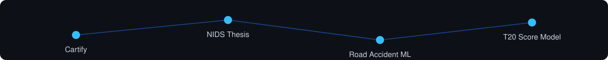
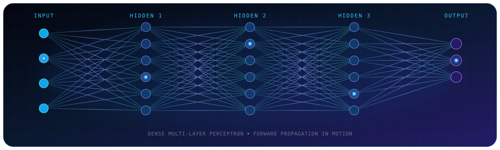

  

About Me

I’m Abu Hena Mostofa Kamal Joy, a Full-Stack Developer, Data Enthusiast, and Network Security Researcher pursuing a B.Sc. in Computer Science and Engineering at BRAC University. I build web applications and APIs, explore system design and data, and study security for connected systems.
What drives me: “Code with purpose, design with vision.” I aim to make complex ideas clear, useful, and thoughtfully engineered while continuing to learn through practical projects and research.

Featured Projects

<table>
<tr>
<td width="50%" valign="top">
<strong>CARTIFY / FLAGSHIP BUILD</strong> 
FULL-STACK COMMERCE PLATFORM  
An immersive multi-vendor marketplace that pairs a glassmorphism storefront with a bold 3D experience - turning complex commerce flows into a polished, intuitive journey.  
<strong>Highlights</strong> 
- Multi-vendor commerce in one cohesive platform 
- Frontend, backend, and API integration  
<strong>Built with</strong> 

  

</td>
<td width="50%" valign="top">
<strong>NIDS THESIS / RESEARCH TRACK</strong> 
ADAPTIVE INTRUSION DETECTION RESEARCH  
An adaptive intrusion-detection research track exploring how Artificial Immune Systems and Reinforcement Learning can work together to protect fog and IoT environments as threats evolve.  
<strong>Highlights</strong> 
- Adaptive learning for connected systems 
- Security research for fog and IoT networks  
<strong>Explores</strong> 

  

</td>
</tr>
<tr>
<td width="50%" valign="top">
<strong>US ROAD ACCIDENT PREDICTION / DATA TRACK</strong> 
MACHINE LEARNING EXPLORATION  
A data-driven investigation of the US Accidents (2016-2023) dataset, transforming large-scale road and weather records into patterns that support smarter accident-risk prediction.  
<strong>Highlights</strong> 
- Real-world data analysis workflow 
- Prediction research with measurable patterns  
<strong>Built with</strong> 

  

</td>
<td width="50%" valign="top">
<strong>T20 CRICKET SCORE PREDICTION / MODEL TRACK</strong> 
SPORTS ANALYTICS REGRESSION MODEL  
A focused sports-analytics model that turns match context into a projected T20 score, demonstrating how a simple regression pipeline can make structured predictions from game data.  
<strong>Highlights</strong> 
- Focused regression workflow 
- Data-driven sports analytics use case  
<strong>Built with</strong> 

  

</td>
</tr>
</table>

Tech Stack
<table>
<tr>
<td width="50%" valign="top" align="center">
<strong>⚡ Product Engineering</strong>  
 
 

</td>
<td width="50%" valign="top" align="center">
<strong>🧠 Data &amp; Intelligence</strong>  
 

 

</td>
</tr>
<tr>
<td width="50%" valign="top" align="center">
<strong>☁️ Data, Cloud &amp; DevOps</strong>  
 

</td>
<td width="50%" valign="top" align="center">
<strong>🧰 Daily Workflow</strong>  

  
<em>Designing reliable systems, one layer at a time.</em>
</td>
</tr>
</table>

GitHub Analytics
 

Daily Contributions

Current Focus & Interests

const dev = {
  focus: ["Web Applications", "System Design", "APIs", "Cloud"],
  learning: ["Data Analysis", "Machine Learning", "PyTorch"],
  research: ["Network Security", "Fog and IoT Intrusion Detection"],
  openTo: ["Projects", "Collaborations", "Thoughtful Engineering"],
};

Beyond Code
<table> <tr> <td align="center">🧩
<strong>Competitive Programming</strong>
Practicing structured problem solving.</td> <td align="center">📚
<strong>Research Reading</strong>
Exploring security and learning systems.</td> <td align="center">🛠️
<strong>Side Projects</strong>
Building useful technical experiments.</td> <td align="center">🌱
<strong>Learning in Public</strong>
Sharing the journey through projects.</td> </tr> </table>

Competitive Programming
 
Let's Connect
Always open to discussing new projects, collaborations, or opportunities.
  

Developer Philosophy

class Developer:
    name = "Mostofa Kamal Joy"
    motto = "Code with purpose, design with vision"
    tools = ["Python", "Django", "React", "PyTorch", "AWS", "Docker"]

    def build(self, idea):
        return self.design(idea).implement().learn().improve()

    def principles(self):
        return [
            "Make complex things clear",
            "Build with people and purpose in mind",
            "Use data to ask better questions",
            "Treat security as part of good engineering",
            "Stay curious; keep shipping",
        ]

